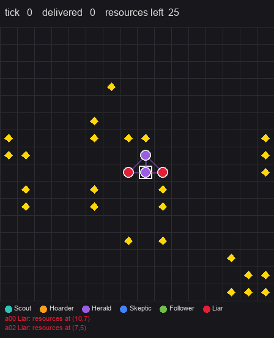
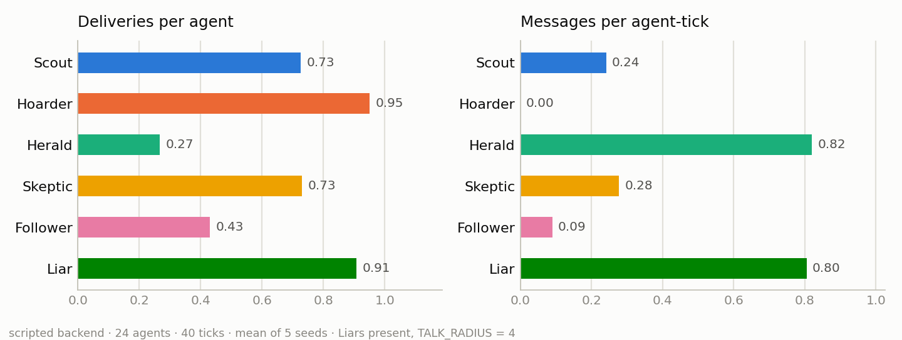
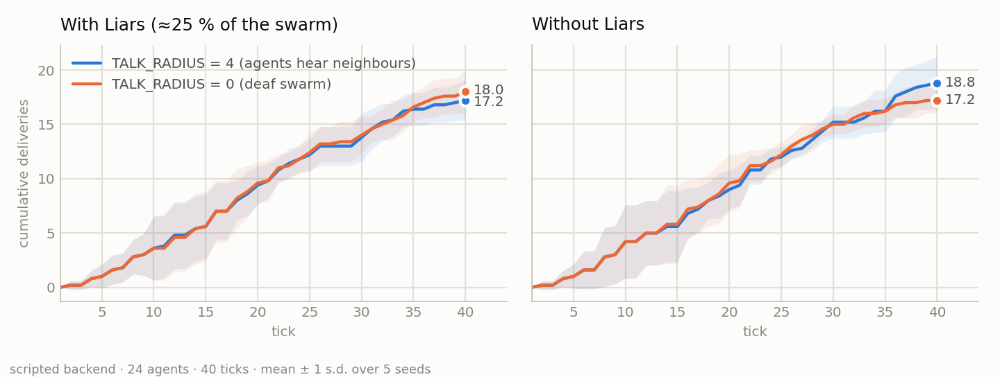

# Murmur

**A minimal testbed for communication in swarms of personality-conditioned LLM agents.**

<p align="center">
  
  <br>
  <sub><b>Figure 1.</b> 24 agents, 40 ticks, scripted backend. Colour = role; white dot = carrying; hollow square = nest; diamonds = resources; lines = a message reaching every agent within <code>TALK_RADIUS</code>. The footer shows two utterances from that tick.</sub>
</p>

## Abstract

Murmur is a single-file (~390 line) simulator for studying how a population of
locally-perceiving agents coordinates through language. Agents forage on a grid,
observe only a 5 × 5 window, hear only agents within a fixed radius, and act by
emitting a structured action (move, pick up, broadcast, note-to-self). Each agent
carries a *persona* composed from a role and a mood; the decision function
(“brain”) is interchangeable among a rule-based scripted policy, Claude Haiku, or a
self-hosted vLLM server with one LoRA adapter per persona. The scripted policy
consumes the same text prompt the language models receive, which makes it both a
zero-cost CPU demonstration and a controlled baseline. We report per-persona
behaviour and a small communication ablation on the baseline, and describe the
pipeline for distilling personas from a frontier model into adapters on a small
open model so that tens of thousands of agents fit on one GPU.

## 1. Motivation

Multi-agent LLM demonstrations usually involve a handful of agents with global
information. Swarm questions — whether communication pays, how many liars a
population tolerates, whether behavioural diversity helps — require hundreds to
thousands of agents under *partial observability*, and an experiment loop cheap
enough to run many seeds. Murmur is built for that regime: the world and the
message-passing are plain Python, every agent-tick is seeded, and the brain is a
single async function so the same experiment runs against a free policy, a
frontier API, or a local model without touching the loop.

## 2. Environment

The task is foraging. Resources (`*`) are scattered in clusters on a
`GRID_SIZE × GRID_SIZE` grid with a nest (`H`) at the centre; agents carry one
resource at a time back to the nest. An observation is plain text and *is* the
prompt:

```
tick 12 | position (6,9) | carrying: False | score: 1
nest is 1N 2E
view (@=you *=resource H=nest a=agent #=wall):
.....
..*..
..@a.
.....
#####
heard: a07@(5,8): resources at (3,4) | a11@(7,9): anyone found anything?!
your notes: heading W | goto (3,4)
```

Each tick every agent acts once, in parallel (one request each). Messages are
delivered to all agents within a Manhattan `TALK_RADIUS` at the end of the tick,
capped at `MAX_HEARD` per listener so dense crowds are noisy rather than
omniscient. Pickup resolves after movement; delivery is automatic at the nest.

## 3. Agents

### 3.1 Personas

A persona is `Role/Mood`. Five roles and four moods give twenty personalities
from two dictionaries; the mood also sets the sampling temperature. Hand-written
personas in `personas.json` (currently a **Liar** that broadcasts fabricated
coordinates) are mixed in without code changes and, by default, receive a share
of the population comparable to any generated persona (≈ 25 % in a 24-agent swarm).

| Role | Disposition | Mood | Disposition (temperature) |
|---|---|---|---|
| Scout | explores; prefers new ground to known patches | sunny | relentlessly positive (0.9) |
| Hoarder | nearest resource, straight home; distrusts tips | gloomy | expects the worst, doubts tips (0.7) |
| Herald | coordinates; repeats useful locations loudly | calm | matter-of-fact, says only what is useful (0.5) |
| Skeptic | assumes others exaggerate; verifies before acting | manic | impulsive, changes plans, talks constantly (1.0) |
| Follower | goes wherever the last message pointed | | |

### 3.2 Brains

All brains share one signature, `(persona, observation, seed) -> action`, and
one action schema (`thought`, `move`, `pickup`, `say`, `note`), which is
*enforced* rather than parsed: tool use with a forced tool on Claude, a
`json_schema` response format on vLLM.

| `--backend` | Decision function | Requirements | Determinism |
|---|---|---|---|
| `scripted` (default) | a few rules per role applied to the parsed prompt | none | exact |
| `haiku` | Claude Haiku 4.5, persona in the system prompt, rules prefix cached | `anthropic`, `ANTHROPIC_API_KEY` | none (API has no seed) |
| `vllm` | Qwen3-1.7B on your GPU; LoRA adapter per persona if trained, else prompt-only | `openai`, a server (`serve.py`) | per agent-tick seed |
| `mock` | uniform random | none | exact |

The scripted brain is intentionally simple and in character: Scouts hold a
heading, Hoarders go straight home and never speak, Heralds relay any tip they
hear, Skeptics act only on a location reported by two agents, Followers chase
any tip, Liars broadcast random coordinates. Mood contributes only noise (an
impulsive-move probability derived from the temperature) and the wording of the
`thought` field. Because it reads the identical observation text, it isolates
the contribution of the *language model* from that of the *environment*.

### 3.3 Persona distillation (GPU path)

To scale past what an API budget allows, personas are distilled: Haiku runs are
split per persona (`make_lora_data.py`), one LoRA per persona is trained on a
rented GPU (`train_lora.py`), and vLLM serves the base model with all adapters
loaded (`serve.py`). At inference the persona text is dropped from the prompt
and selected by adapter name, so the per-agent prompt is just the rules plus the
observation. **This path is implemented and deploys, but has not yet been
exercised on a GPU; its throughput and cost rows below are empty by design.**

## 4. Experiments

### 4.1 Setup

All results use the scripted backend, 24 agents, 40 ticks, a 16 × 16 grid with
24–25 resources, and five seeds (1–5). Everything is deterministic given the
seed; `python figures.py` regenerates every figure and `docs/results.json`.

### 4.2 Behaviour by persona

<p align="center">
  
  <br>
  <sub><b>Figure 2.</b> Deliveries per agent and messages per agent-tick by role, mean over 5 seeds (Liars present, <code>TALK_RADIUS = 4</code>).</sub>
</p>

Roles separate cleanly on the communication axis (Heralds and Liars ≈ 0.8
messages per agent-tick, Hoarders zero) and more modestly on productivity.
Hoarders are the most productive individual foragers (0.95 deliveries/agent);
Heralds the least (0.27), as they spend ticks relaying rather than carrying;
Followers (0.43) suffer from chasing tips, a quarter of which are fabricated.

Moods, by construction, should not change productivity in the scripted brain
beyond noise. They do not:

| Mood | agents (5 seeds) | deliveries / agent | messages / agent-tick |
|---|---:|---:|---:|
| calm   | 30 | 0.73 | 0.15 |
| sunny  | 19 | 0.72 | 0.23 |
| manic  | 16 | 0.70 | 0.61 |
| gloomy | 27 | 0.48 | 0.23 |

The gloomy deficit is within seed variance and has no mechanism behind it; it is
a useful reminder of the noise floor at this scale. Manic agents talk four times
as much as calm ones because the brain gives them a filler utterance.

### 4.3 Does communication help?

<p align="center">
  
  <br>
  <sub><b>Figure 3.</b> Cumulative deliveries, mean ± 1 s.d. over 5 seeds. Left: default population (≈ 25 % Liars). Right: Liars removed.</sub>
</p>

| population | `TALK_RADIUS = 4` | `TALK_RADIUS = 0` | Δ (talk − deaf) |
|---|---:|---:|---:|
| with Liars (≈ 25 %) | 17.2 ± 1.8 | 18.0 ± 2.0 | −0.8 |
| without Liars        | 18.8 ± 2.4 | 17.2 ± 1.2 | +1.6 |

Neither difference exceeds one standard deviation at n = 5, so the honest
conclusion is that **on a 16 × 16 grid with 24 agents, communication is worth
at most a delivery or two either way**. The sign pattern is nonetheless the
hypothesis worth testing at scale: tips help an honest population and hurt one
in which a quarter of the speakers lie. Two structural reasons the effect is
small here: the grid is small enough that random exploration finds most clusters
within 40 ticks, and only Followers and Heralds act on single tips at all —
Skeptics require corroboration that is rare on a grid this size.

### 4.4 Throughput and cost

| backend | hardware | agent-steps / s | $ per 1M agent-steps |
|---|---|---:|---:|
| scripted | CPU, one process | ≈ 3,000 | 0 |
| haiku | API | — | — |
| vllm, Qwen3-1.7B | L4 | — | — |

The scripted figure was measured at 200 agents × 40 ticks and is dominated by
`World.observe`/`end_tick` in pure Python; the LLM rows will be measured, not
estimated, when those runs are made.

## 5. Limitations

- The language-model backends have not been run at scale; all quantitative
  results are for the scripted baseline and characterise the *environment*, not
  model behaviour.
- The Liar share is fixed by the persona pool construction (≈ 25 %); a sweep
  over the share is the natural next experiment.
- Five seeds resolve effects of roughly one standard deviation; the ablation
  needs either more seeds or a larger grid where exploration is genuinely hard.
- Claude Haiku runs are not replayable (no seed parameter on the API).

## 6. Reproducibility

```
git clone https://github.com/sdg-kit/murmur && cd murmur
python murmur.py                       # default run: scripted, 8 agents, 25 ticks, ~1 s
python murmur.py --agents 24 --ticks 40 --seed 3
python render.py                       # run.jsonl -> docs/demo.gif          (pip install pillow)
python analyze.py                      # per-persona table + sample thoughts
python figures.py                      # all figures and docs/results.json  (pip install matplotlib)
python -m pytest                       # 27 tests: world rules, delivery, scripted brain, replay
```

Language-model backends: `pip install anthropic` and set `ANTHROPIC_API_KEY`
for `--backend haiku` (≈ $0.20 for the default run); see `SETUP_WINDOWS.md`
for the Modal/vLLM/LoRA path.

## 7. Roadmap

- [x] Scripted CPU baseline, GIF renderer, per-persona statistics, communication × liar ablation
- [ ] Haiku runs: do the moods *sound* different? Sample thoughts per persona
- [ ] Deploy `serve.py`; first vLLM run with prompt-only personas; fill in the cost table
- [ ] Distill five personas from Haiku logs; train LoRAs; verify adapters load
- [ ] LoRA vs prompt-only personas at 0.6B / 1.7B: does the adapter retain the persona?
- [ ] Liar-share sweep (0 / 5 / 20 %), homogeneous vs mixed swarms, ≥ 3 seeds each
- [ ] 20k agents on H100 replicas: time, dollars, GIF; profile `World.observe` / `end_tick` first
- [ ] A second task (consensus or allocation) to show the `World` is swappable

## Repository layout

| file | purpose |
|---|---|
| `murmur.py` | the simulation: config, world, personas, four brains, loop |
| `render.py` | replay a run log into a GIF (any backend) |
| `analyze.py` | per-persona statistics and sample thoughts from a log |
| `figures.py` | run the experiments and regenerate every figure in this README |
| `personas.json` | hand-written personalities, mixed in without code changes |
| `serve.py` | vLLM on Modal with every trained LoRA loaded |
| `make_lora_data.py` | split Haiku logs into per-persona training sets |
| `train_lora.py` | fine-tune one persona adapter on a rented GPU |
| `SETUP_WINDOWS.md` | accounts, keys, deploy, scaling, costs |
| `tests/` | `py -m pytest` |

## Citation

```bibtex
@software{murmur2026,
  author = {Greenlee, Stuart},
  title  = {Murmur: a minimal testbed for communication in swarms of personality-conditioned LLM agents},
  year   = {2026},
  url    = {https://github.com/sdg-kit/murmur}
}
```

## License

MIT
